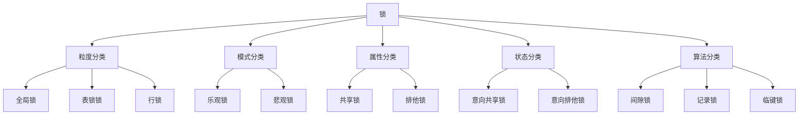
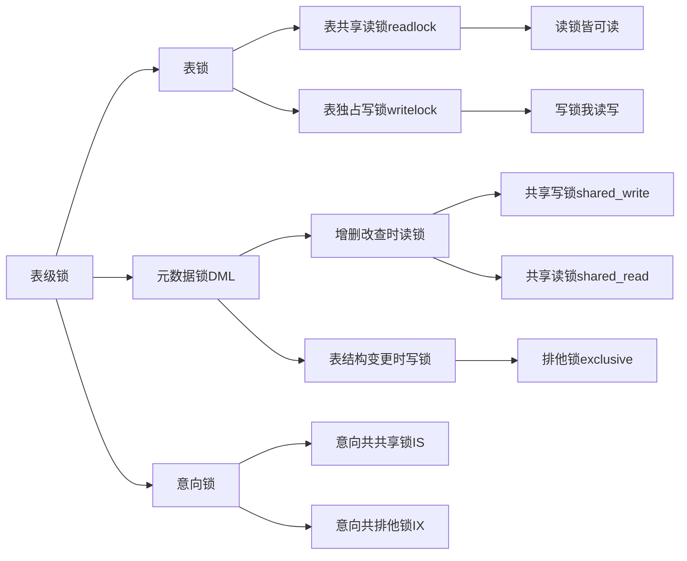

# MYSQL

## 基础篇

### 简介

进Mysql配置文件设置客户端和服务端的字符集编码
路径：找到Mysql安装路径，*/data/my.ini        也可能是mysql.ini

/## 设置客户端字符集编码
default-character-set=gbk

/## 设置服务端字符集编码
character-set-server=utf8

Mysql关系型数据库（由多张互相连接的二维表），SQL，结构化查询语言
DMQC:definition定义，manipulation操作，query查询，control控制
DDL:对库、表创建修改删除  DML：对表内数据增删改   DQL：对数据表查询 DCL：权限，安全，用户
登录：mysql -uroot -p123456 [-h192.168.181.3]

| 常用指令(不用登录mysql) | 解释说明                                     |
| ----------------------- | -------------------------------------------- |
| mysql                   | mysql客户端工具                              |
| mysqladmin              | mysql管理工具                                |
| mysqlbinlog             | 二进制日志查看工具                           |
| mysqlshow               | 查看库表字段的统计信息                       |
| mysqldump               | 数据备份工具                                 |
| mysqlimport/source      | 数据导入工具(mysqldump导出的txt)/sql文件导入 |

#### 备份

备份：mysqldump -uroot -p 库名>路径/自命名.sql        路径不能有空格
还原：mysql -uroot -p 库名<路径/自命名.sql
备份所有库--all-databases

数据库基本数据类型：
设置时区：set time zone='+8:00'

|       数据类型       |     范围      |            |
| :------------------: | :-----------: | :--------: |
|         int          |     4字节     |            |
|        float         |     4字节     |  6位有效   |
|        double        |     8字节     |  16位有效  |
|   varchar可变长度    |  65535个字符  |            |
|       char定长       |   255个字符   |            |
|         date         | 3字节yy-mm-dd |            |
| datetime不受时区影响 |     5字节     |            |
| datestamp受时区影响  |     4字节     |            |
|       enum枚举       |               | 存储单一值 |
|       set集合        |               | 存储多个值 |

#### MySQL的系统库

##### performance_schema

保存MySQL服务器运行过程时的状态信息，算是对MySQL服务器的一个性能监控。包括统计最近执行了哪些语句，在执行过程的每个阶段都花费了多长时间，内存的使用情况等等信息。

##### information_schema

保存所有其他数据库的信息，比如有哪些表、哪些视图、哪些触发器、哪些列、哪些索引。这些是一些描述性信息，称之为元数据。

##### sys

通过视图把information_schema和performance_schema结合起来，让程序员可以更方便的了解MySQL服务器的一些性能信息。

##### mysql

存储MySQL用户账户和权限信息，还有一些存储过程、事件的定义信息，一些运行过程中产生的日志信息，一些帮助信息以及时区信息等。

### DDL

#### 对库定义

```sql
--查看数据库
show DATABASES;
--创建数据库
create database `数据库名`;
create database if no exists `数据库名`;
复制表结构和数据：**create table** 新表 **as** (select * from 旧表);
复制表结构：**create table** 新表 **as** (select * from 旧表 where 1=2);
复制表数据:insert into 新表 (column1,column2...) select column1,column2... from table_name_old;
sql server：select * into 新表 from 旧表

--删除数据库
drop database `数据库名`;
drop database if exists `数据库名`;
--查看当前使用的哪个数据库
select database();
--切换数据库
use `数据库名`;

#### 对表定义

--查看当前数据库下所有表
show tables;
--查看表结构
desc `表名`;
--创建表
create table `表名`(
`字段名` 数据类型,
`字段名` 数据类型，
primary key(`列`),
foreign key(`列`) references 主表(列)
);
--删除表
drop table `表名`；
drop table if exists `表名`;

开发时使用DDL里面的：truncate table 表名;
delete支持回滚，truncate不支持回滚
--**修改表的数据类型表名，（修改数据用update）**
--修改名字，新增一列，修改数据类型，修改列名和数据类型，删除列
alter table `表名` rename to `表名`;
alter table `表名` add `列名` `数据类型`;
alter table `表名` modify `列名` `新数据类型`;
alter table `表名` change `列名` `新列名` `新数据类型`;也可以保持数据类型不动
alter table `表名` drop `列名`;
```

| 操作               | 语法      |
| ------------------ | --------- |
| 添加列和约束       | add       |
| 重命名表名         | rename to |
| 修改列数据类型     | modify    |
| 修改列名或数据类型 | change    |
| 删除一列和约束     | drop      |

### DML

```sql
--添加数据insert
1.指定列添加
insert into 表名 (列名1,列名3) values (数据1,数据3);
2.所有列添加数据
insert into 表名 values (数据1,数据2,数据3);
3.批量添加数据
insert into 表名(列名1，列名3)  values (数据1,数据3)，(数据1,数据3)，(数据1,数据3);
4.通过复制来插入数据
复制表数据:insert into 表名(列1,列2...) select 列1,列2... from 表名;

--修改数据update
--不设条件会改全部，不建议
修改整个表：update 表名 set 列名1=新值,列名2=新值....;       可以撤回
修改指定行数据：update 表名 set 列名1=新值,列名2=新值.... where 条件；

--删除数据delete from
--删除满足条件的行记录
delete from 表名 where 条件:
--删除所有行,两者区别,前者一行行删,后者先drop再create
delete from 表名 where 真;
开发时使用DDL里面的：truncate table 表名;
delete支持回滚,truncate不支持回滚（sqlsever可以回滚）
```

### DQL

![![条件符号]](/images/条件符号.png)

like模糊查询：%表示0个或1个或多个任意字符,_表示一个字符；比如姓马的人like ‘马%’,**如果要直接查询含有%的"/%"**

在sql server中还有范围匹配[]         [0-9a-zA-Z] 为数字大小写字母

自定义转义字符：like '!%!%' ESCAPE '!'         -- 自定义转义字符！

聚合函数不能对NULL进行计算，使用时可以**avg(ifnull(列名，0))**，如果为，设置为0

![![聚合函数]](/images/聚合函数.png)

[]里面可写可不写，**当有多个排序条件时，当前边的条件值一样时，才会根据第二个条件排序**。

变量：用户变量，@变量名
赋值：set 变量名=值       select 变量名:=值

```sql
select [distinct]（去除重复记录）
    字段列表 [as]  别名
from [as]  别名
    表名列表
where         --条件查询
    条件
group by    --分组查询（select什么就分什么组，其他用聚合函数，按唯一值分组可以写所有列，group_concat(字段[order by 字段]) 将未分组的列拼接）
    分组列表
having    --注意和where的区别，where中不能使用聚合函数
    分组后条件
[with rollup] 分组后在最后一行加一个汇总行
order by   --排序查询
    排序字段1 [desc|asc]（默认升序，desc降序），排序字段2 [desc|asc]（默认升序，desc降序）
limit  n,m  --分页查询     1，3查询结果为第234条    0，5简写5
    起始索引，查询行数

！mysql分页查询limit，Oracle分页查询rownumber，sql sever分页查询top

 **sql执行顺序：**
from-where-group by-having-select-order by-limit
```

### DCL

#### 用户管理

查询：use mysql;select * from user;
创建：create user '用户名'@'主机名' identified by '密码'；
修改密码：
alter user '用户名'@'主机名' identified by '新密码'；
alter user  '用户名'@'主机名'  identified with my_native_password by '新密码'；
删除用户：drop user  '用户名'@'主机名'

#### 权限管理

```sql
查询权限：show grants for  '用户名'@'主机名';
授予权限：grant 权限列表 on 数据库名.表名 to '用户名'@'主机名' [with grant option];
with grant opion允许被授权方给予他人权限
撤销权限：revoke 权限列表 on 数据库名.表名 from 用户名'@'主机名';

权限列表：all，all privileges，select，insert，update，delete，alter，drop，create
所有数据库.所有表：* . *

刷新权限：flush pivileges;
```

### 约束

**《维护和保证数据一致性和完整性》，mysql5个约束+Oracle check检查约束**
约束可以在创建表的时候在字段后添加，也可以使用alter添加
**主键约束：primary key  [auto_increment]**
auto_increment=起始值 设置起始值

添加主键：alter table 表名 add prinmary key（字段）;
删除主键：alter table 表名 drop primary key;

**唯一约束：unique**      不能重复

添加唯一约束：alter table 表名 add unique（字段）

***非空约束：not null**      不能为空

添加唯一约束：alter table 表名 modify 字段 类型 not null
sql sever：alter table 表名 alter column 列名 数据类型 not null

***默认值约束：default**      设置默认值，now()mysql函数获取当前系统时间

添加唯一约束：alter table 表名 modify 字段 类型 default 默认值
sql sever添加默认值约束：alter table 表名 add constraint default 默认值 for 列名

**外键约束：constraint 外键名 foreign key(字段) references 主表名(主表主键)**       限制外键中数据来自主键

表关系：**一对多**，多方表设外键指向另一表的主键；**多对多**，创建第三张表作为中间表，设置两个外键分别指向各自主键；**一对一**，合并或者设置任意一个外键指向另一个主键

主键外键关系：添加先主再从；删除先从再主；修改主键被引用不能修改(外键级联：on update/delete cascade设置外键时设置该项)

添加外键约束：alter table 表名 add constraint 外键名 froeign key(当前表外键字段) references 主表(主表主键)

### 多表查询

#### 笛卡尔积

笛卡尔积是两张表每一项互相交叉组合的结果。**消除笛卡尔积：主表.主键字段=从表.外键字段**

#### 内连接join和inner join和where

隐式内连接:select 列名 from 左表，右表 where 主表.主键=从表.外键

**显式内连接**:select 列名 from 左表 inner join 右表 on 主表.主键=从表.外键
              from 表1 join 表2 using(同名的列名)

区别：隐式内连接先做笛卡尔积再过滤不匹配的行；显示内连接先匹配连接条件再返回匹配的行。

#### 外连接

**左外连接**：左表所有记录都出现在结果中，如果右表没有匹配的记录，使用NULL填充，

select 列名 from 左表 left join 右表 on 主表.主键=从表.外键

**右外连接**：同上，改为右表

select 列名 from 左表 right join 右表 on 主表.主键=从表.外键

**全外连接**
mysql不支持，既左右外连接

#### 子查询

子查询结果为**单行单列**，父查询使用比较运算符**<>=**;**多行单列**，父查询使用**in、any、all**；**多行多列**，需要**取别名**当作临时表来使用该子查询的表格

查询工资大于5000的员工信息
select id，name，gender，salary，dept_id from emp
where salary>5000；
基于以上结果，关联dept表进行多表查询
实现方式一：select emp.id,emp.name.emp.gender,emp.salary
from dept inner join (select id，name，gender，salary，dept_id from emp
where salary>5000；) as emp
on dept.id=emp.dept_id
实现方式二：select emp.id,emp.name,emp.gender,emp.salary,dept.id,dept.name
from dept right join emp
    on dept.id=emp.dept_id
where emp.salary in (select salary from emp where salary>5000)

#### 联合查询union

select ......union [all] select .....
前后列数和[数据类型]要一致,all是不去重

### 事务

一种机制，操作序列，包含多个步骤的业务操作，通过临时事务日志实现

四个标准属性ACID：一个不可分割的工作逻辑单元
**原子性atom**（要么全部执行成功，要么全部执行失败）；
**一致性consist**（**在事务开始之前和事务结束以后**，**数据库的完整性**没有被破坏）；
**隔离性isolation**（数据库允许**多个并发事务同时对其数据进行读写和修改**的能力，隔离性可以防止多个事务并发执行时由于交叉执行而导致数据的不一致）；
**持久性durability**(事务处理结束后，**对数据的修改就是永久**的，即便系统故障也不会丢失)

与事务控制有关的 SQL 命令包括：

| 语法                         | 含义                                                |
| ---------------------------- | --------------------------------------------------- |
| BEGIN 或者 START TRANSACTION | 开始事务                                            |
| COMMIT                       | 提交事务；将临时日志文件同步到数据库                |
| ROLLBACK                     | 回滚事务；将临时日志文件清空                        |
| SAVEPOINT                    | 在事务内部设置回滚标记点；                          |
| RELEASE SAVEPOINT            | 删除回滚标记点；                                    |
| ROLLBACK TO                  | 将事务回滚到标记点（ROLLBACK 命令的一种变形写法）。 |

一个事务要么提交（Commit），要么回滚（Rollback），提交意味着成功，回滚意味着失败。编写事务代码时，以 BEGIN 命令开头，后跟一条或者多条 SQL 语句，最后书写 COMMIT 或者 ROLLBACK 命令；**COMMIT 和 ROLLBACK 对应事务的两种状态，只能出现一个**。

事务控制命令仅能与 INSERT、UPDATE、DELETE 和 SELECT一起使用，在创建或者删除表时不能使用事务，因为这些操作在数据库中是自动提交的。

#### 系统设置

select @@autocommit；查看mysql的事务默认提交方式
set autocommit=0;           修改mysql默认提交方式，改为手动

#### 事务隔离级别

安全：串行化>可重复读>读已提交>读未提交    性能相反
查看隔离级别：show variables like '%isolation%'
设置隔离级别（**设置全局事务隔离水平**）：set [session|global] transcation isolation level [read uncommitted|.....]

- 脏读：读到其他事务未提交(回滚 )的数据；
- 不可重复读：同一人前后读取的数据不一致；
- 幻读：同一人前后读取的记录数量不一致。

| 级别 | 脏读 | 不可重复读 | 幻读 | 数据库默认隔离级别 |
| :----: | ---- | :----: | :---: | :----------: |
| 读未提交read uncommitted | 是 | 是 | 是 | |
| 读已提交read committed | 否 | 是 | 是 | Oracle和SQL sever |
| 可重复读repeatable read | 否 | 否 | 是 | Mysql |
| 串行化serializable | 否 | 否 | 否 | 否 |

mysql在可重复读下幻读的场景1

![![聚合函数]](/images/幻读场景1.png)

场景2
![![聚合函数]](/images/幻读场景2.png)

### 函数

#### 日期函数

| 功能 | 语法 |
| --- | --- |
| 返回当前日期/时间/日期和时间 | current_date/current_time/current_timestamp |
| 返回月/周/年的第几天 | dayofmonth()< br />dayofweek()/dayofyear() |
| 从时间d中返回type | extract(type FROM d) |
| 日期 d 加上一个时间段后的日期 | date_add(d,INTERVAL 值 type)/date_sub() |
| 计算时间点差(时间1-时间2) | timestampdiff(时间格式,时间1,时间2) |
| 计算时间差(时间1-时间2) | datediff(时间1，时间2) |
| 返回年月日 | date(时间) |

#### 字符函数

| 功能                                           | 语法                                 | 效果          |
| ---------------------------------------------- | ------------------------------------ | ------------- |
| 返回字符串 s 的字符数                          | CHAR_LENGTH("RUNOOB")                | 5             |
| 合并多个字符串，并添加分隔符                   | CONCAT_WS("-", "SQL",  "is", "fun!") | SQL-IS-is-fun |
| 从字符串第一个位置开始的 6 个字符替换为 runoob | INSERT("com", 1, 2, "www")           | cwww          |
| 获取 b 在字符串 abc 中的位置                   | LOCATE('st','myteststring')          | 5             |
| 将字符串 s2 替代字符串 s 中的字符串 s1         | REPLACE('abc','a','x')               | xbc           |
| 从字符串 RUNOOB 中的第 2 个位置截取 3个 字符   | SUBSTRING("RUNOOB", 2, 3)            | UNO           |
| 去掉字符串 RUNOOB 的首尾空格                   | TRIM('    RUNOOB    ')               | RUNOOB        |

#### 数学函数

| 功能 | 语法 | 效果 |
| --- | ------------------- | ------ |
| 返回离 x 最近的整数，可选参数 y 表示要四舍五入的小数位数，如果省略，则返回整数 | round'(345.156, 2) | 345.16 |
| 返回数值 x 保留到小数点后 y 位的值 | TRUNCATE(1.23456,3) | 1.234 |

#### 高级函数

| 排序函数/分布函数/聚合函数 | 高级函数 | 内置参数 |
   | --- | --- | --- |
  | rank() 并列跳跃 | 窗口函数over() | 分区 partition by |
  | dense_rank() 并列不跳跃 | | 排序order by |
  | row_number() 记行号 | | rows between 开始行 and 结束行 |
  | percent_rank() 每行(rank-1) / (rows-1) | | |
  | cume_dist() 分组内<=当前 rank 值的行数 / 分组内总行数 | | |

低版本的mysql没有窗口函数，通过用户变量@来添加行号
set @i=0;
select @i:=@i+1

## 进阶篇

### innodb存储引擎

innoDB存储逻辑:支持事务，外键，行级锁提高并发性能

#### 逻辑存储结果

![![innodb]](/images/innodb.png)

| 存储空间 | |
| --- | --- |
| 表空间 | ibd文件 |
| 段 | 包括数据段(叶子节点)、索引段、回滚段 |
| 区 | 每个区1M，默认一页16K，所以一个区有64页 |
| 页 | 存储引擎磁盘管理的最小单元，为保持页的连续性，引擎每次申请4-5页 |
| 行 | 按行数据存放 |

#### 架构

![![innodb架构]](/images/innodb架构.png)

内存结构：缓冲池、更改缓冲区、日志缓冲区、自适应哈希索引
磁盘结构：系统表空间、每个表的表空间、通用表空间、撤销(undo)表空间、临时表空间、双写缓冲区、重做日志redo(重做日志缓冲(内存中)+重做日志文件(磁盘中))
后台线程：master thread、IO thread、purge thread回收已提交的撤销日志、page cleaner thread协助master thread刷新脏页到磁盘

#### 事务原理

redo log+undo log负责acd     原子，一致，持久
锁机制+MVCC负责i        隔离

#### MVCC(多版本并发控制)

当前读：对读取的记录加锁
select...lock in share mode(S)    select...for update、update、insert、delete(X)

快照读：不加锁读取
read committed：每次select生成一个快照读
repeatable read：开启事务后，第一个select为快照读
serializable：快照读变成当前读

##### 实现原理(隐藏字段+undo log+readview)

| 隐藏字段(建表时会自动生成) | 说明                             |
| -------------------------- | -------------------------------- |
| DB_TRX_ID                  | 最近修改的事务ID                 |
| DB_ROLL_PTR                | 回滚指针，配合undo log           |
| DB_ROW_ID                  | 隐藏主键，如果表结构没有主键生成 |

查看方法 ：idb2sdi idb文件名

undo log日志：通过隐藏字段的回滚指针形成**版本链**来确定回滚到哪个事务
insert事务提交后undo log可立即删除；update和delete不会

readview(读视图)：快照读执行时MVCC提取数据的依据

| 字段           | 含义                           |
| -------------- | ------------------------------ |
| m_ids          | 当前活跃事务的id集合           |
| min_trx_id     | 最小活跃事务id                 |
| max_trx_id     | 预分配事务id，当前最大事务id+1 |
| creator_trx_id | readview创建者的事务id         |

![![版本链数据访问规则]](/images/版本链数据访问规则.png)

不同的隔离级别，生成readview的时机不同：
read committed：事务每次执行快照读时生成
repeatable read：仅在事务第一次执行快照读时生成

### 索引(数据结构，B+tree)

**索引大大提高查询效率，但是降低更新表的速度**
查询当前数据库是查询密集型还是修改密集型(查询或修改语句执行次数多)
show global status like 'Com       '   七条下划线

#### 语法

主键索引，唯一索引，普通索引，组合索引，全文索引，hash索引
创建索引：create [unique|fulltext] index 索引名 on 表名(字段1，字段2.....)
查看索引：show index from 表名
添加索引：alter table 表名 add index(字段)
删除索引：drop index 索引名 on 表名
对于约束会自动创建索引

按存储结构分类：

- 聚集索引：叶子节点保存行数据
- 二级索引：叶子节点保存主键(索引结构和数据分开存放的索引)

按数据结构分类：B+tree、hash索引、T-tree......

#### 使用规则

- 最左前缀匹配原则
- 频繁查找，不频繁修改
- 能够有效区分数据
- 扩展索引不新建索引，索引扩展成(a,b),而不是创建a和b
- 外键
- text，image，bit数据不建

**索引失效**：<https://cloud.tencent.com/developer/article/1992920>

### sql性能分析

#### 慢查询日志

来分析哪些语句的执行时间过长
开启方式：linux下mysql配置文件/etc/my.cnf
          windows下mysql配置文件my.ini或者mysql.ini

![![慢查询]](/images/慢查询.png)

慢查询日志：linux下的路径/var/lib/mysql/localhost-slow.log

#### profile

分析时间耗费情况
查看是否有该功能：select @@have_profiling
开启：set profiling = 1
查看sql'耗时情况:show profiles
查看指定query_id的sql语句各阶段的耗时情况：show profile for query 查询id
查看该查询的cpu占比：show profile cpu for query 查询id

#### explain

explain/desc 来提前预览select语句的执行过程
explain select .........

| 字段         | 说明                                             |
| ------------ | ------------------------------------------------ |
| id           | 操作表的顺序，id越大越先执行                     |
| select_type  | simple,primary,union,subquery                    |
| type         | 性能null>system>const>eq_ref,ref,range,index,all |
| possible_key | 可能用到的索引                                   |
| key          | 实际用到的索引                                   |
| key_len      | 使用到的索引字节数                               |
| rows         | 执行查询的行数(预估值)                           |
| filtered     | 返回结果行数占需读取行数的百分比，越大越好       |

### sql优化

#### 插入数据

- 单次插入->批量插入
- 自动提交事务->手动提交事务
- 主键乱序插入->主键顺序插入
- 大批量插入insert->load

load使用

![![load插入数据]](/images/load插入数据.png)

#### 主键优化

- 尽量降低主键长度
- 插入时尽量顺序插入auto_increment
- 尽量不要使用uuid或其他自然主键(如身份证)做主键
- 业务操作时避免对主键的修改(会动主键索引结构)

#### order by优化

order by有两种排序：using filesort(全表扫描后在缓冲区排序)；using index(有序索引顺序扫描，效率高)

- 根据排序字段建立索引，多字段时遵循最左前缀法则
- 尽量使用覆盖索引(避免select *)
- 对于不可避免的using filesort，可以适当增加缓冲区sort_buffer_size大小

#### group by优化

using tempory和using index

- 通过索引提高效率
- 索引满足最左前缀法则

#### limit优化

当查询limit a,b，对于a过大，而b较小时,例如limit 20000000,10
优化思路覆盖索引+子查询

```sql
-- 优化前
select * from table limit 900000,10;
-- 优化后（id有索引）
select t.*,(select id from table order by id limit 9000000,10) a from table t where s.id=a.id 
```

#### count优化

没有较好的方法，一般通过redis自己计数
效率：count(字段)<count(主键id)<count(1)≈count(*)

#### update优化

由于innodb支持行锁，在update行数据时，如果更新条件有索引，则为行锁；如果没有索引，则为表锁(并发性能降低)。因此避免更新条件没有索引

### 视图(虚拟表)

视图的作用：

- 简单：简化用户对数据的理解和操作，经常使用的查询可以被定义为视图；
- 安全：通过视图，用户只能查询和修改他们见到的数据，保证了安全性；
- 数据独立：帮助用户屏蔽真实表结构变化带来的影响

#### 基础语法

创建视图：create [or replace] view 视图名 as select .......
查询视图：show create view 视图名
         select * from 视图名
修改视图：create or replace view 视图名 as select .......;
         alter view 视图名 as select.......;
              update 视图名 set ... where ...;
删除视图：drop view [if exists] 视图名称

#### 检查选项

with [默认cascaded|local] check option
往视图中插入数据，实际会插入到该视图创建时，所依赖的表中
mysql允许基于另一个视图创建视图，并检查依赖视图中的规则来保持一致性
cascaded级联检查条件；local递归检查条件(检查取决于是否添加了check)

#### 视图的更新

insert，update，delete都是更新
视图中的行与基础表中的行一对一
创建视图时，select中不能包含聚合函数、窗口函数、distinct、group by、having、union，不然无法更新视图

### 存储过程

一组经过预先编译的sql，来完成特定的事情。当存储过程执行一次后，可以将语句**缓存在内存**中，这样下次执行的时候直接使用缓存中的语句。这样就可以提高存储过程的性能。

优点：

- 减少sql重用率
- 减少网络传输量(在开发架构中只需要向sql发送存储过程即可获取持久化数据)
- 提高安全性(不会暴露sql)

#### 变量

```sql
1.系统变量[全局变量/会话变量]
设置/声明:
set [global|session] 变量名=值
重启服务后全局变量恢复默认值，永久更改需更改配置文件

查看:
show [global|session] variables [like '...']
select @@[global|session].变量名 

2.用户变量
设置/声明:
set|select @名称:=值

查看:
select 字段名 into @名称 from 表
select @名称

3.局部变量(begin-end范围内有效)
设置/声明:
create procedure 存储过程名()
begin
declare 变量名 类型[default...]
set 变量名:=值
end

查看:
select @名称
```

#### 创建、调用、查看和删除

```sql
在命令行中把语句结束符号换成自定义符号，避免存储过程创建中断(图形化界面不用)
delimiter //     自定义//为结束符
-- 创建
create precedure 存储过程名称([in|out|inout 参数 参数类型])
约束
begin
declare 变量名 数据类型 [default 值];
set @变量名=值
.....
end

约束：

-- 调用(in参数直接写值，out参数@变量名，inout参数提前设好值然后@变量名)
call 名称([参数])

-- 查看
-- 查询指定数据库xxx的存储过程及状态信息
select * from information_schema.routines where routine_schema='xxx'
-- 查询你某个存储过程的定义
show create procedure

-- 删除
drop procedure [if exists] 名称
```

#### 关键词用法

```sql
-- if
if 条件 then ...;
elseif 条件 then ...;
else ...;
end if;

-- case
case [表达式]
   when 情况1 then ...
   when 情况2 then ...
    else ...
end [case]

-- while
[标记:]while 条件 do
   ...
end while [标记]

-- repeat
[标记:]repeat
   ...
   until 条件
end repeat [标记]

-- loop
-- 标记就是给这个循环取个名字
[标记:] loop
   ...
end loop [标记]

-- 跳出循环 leave(退出循环)和iterate(跳过此次循环)
   leave 标记;
   iterate 标记;

-- 条件处理程序hander(自定义异常处理)
-- 声明
declare [continue继续|exit退出] hander for 情况 [应对操作]
-- 情况有一下几种
sqlstate 状态码;
sqlwarning;01开头的状态码
not found;02开头的状态码
sqlexception;非01和02的状态码
```

#### 游标

```sql
-- 游标cursor(用来存储查询结果集的数据类型)
-- 声明(游标的声明要在普通变量之后)
declare 游标名称 cursor for 查询语句
-- 打开
open 游标名称
-- 获取游标记录(把查询结果里面的列分别赋值给对应的变量名)
fetch 游标名称 into 变量1,变量2...
-- 关闭游标
close 游标名称
```

### 存储函数

有返回值的存储过程，且参数只有in类型(无须声明，默认就是in)

```sql
create function 函数名([参数])
returns 返回值的数据类型 
[特征]
begin
 ...
 return ...;
end

特征说明(在开启二进制日志时，此选项必须填写)：
deterministic:与输入参数类型相同
no sql:不含sql语句
reads sql data:只包含select
modifies sql data:只包含update，delete

LANGUAGE SQL
存储过程语言，默认是sql，说明存储过程中使用的是sql语言编写的，暂时只支持sql，后续可能会支持其他语言

NOT DETERMINISTIC
默认是NOT DETERMINISTIC，只对于同样的输入，输出也是一样的，当前这个值还没有使用

CONTAINS SQL
包括以下四种选择
1.CONTAINS SQL：不包含读写
2.NO SQL：不包含sql
3.READS SQL DATA：包含读，不包含写
4.MODIFIES SQL DATA：包含写
```

### 触发器

在insert/update/delete之前或之后，出发并执行触发器中定义的sql语句集合；
协助应用在数据库端确保数据的完整性，日志记录，数据校验等操作

| 触发器类型     | new和old                                       |
| -------------- | ---------------------------------------------- |
| insert型触发器 | new表示新增数据                                |
| update型触发器 | old表示修改前的数据，new表示将要或已更新的数据 |
| delete型触发器 | old表示将要或已删除的数据                      |

```sql
-- 创建
create trigger 名称
 before|after insert|update|delete 
 on 表名 for each row -- 行级触发器
begin
 ...
 new.列名 就表示新的某一数据
 old.列名 就表示旧的某一数据
end
-- 查看
show triggers
-- 删除
drop trigger [数据库名.]触发器名 -- 默认为当前数据库
```

### 锁

#### 概述

[这一章很乱建议看视频](https://www.bilibili.com/video/BV1po4y1M7k5?p=2&vd_source=c75d57452dfe6d1e8dca457f1ab7a2ac)



#### 全局锁(一致性数据备份)

1.为当前数据库加全局锁：flush tables with read lock

2.备份:mysqldump -h[数据库服务器主机ip] -uroot -p[密码] 库名>[备份的存储路径文件.sql]
备份语句不用在登录mysql服务器后执行

3.释放全局锁：unlock tables

不加锁的一致性数据备份(innodb通过快照读实现):mysqldump **[--single-transaction]** -h[数据库服务器主机ip] -uroot -p[密码] 库名>[备份的存储路径文件.sql]

#### 表级锁



##### 表锁(避免DML和DDL冲突)

加锁：lock tables 表名 read|write
释放锁：unlock tables/客户端连接关闭

##### 元数据锁

系统自动控制，维护元数据的数据一致性；表上有事务时不可对元数据进行写入
增删改查时加读锁(共享读和共享写)；改变表结果时加写锁(排他)

查看元数据锁：
select object_type,object_schema,object_name,lock_type,lock_duration from performance_schema.metadata_locks

##### 意向锁

当**加行锁**时，为了不和**[想要加表锁的另一方]**冲突，会**默认加意向锁**，这样加表锁的一方可以通过检测意向锁来确顶此时是否可以加表锁
意向共享锁IS：select...lock in share mode
意向排他锁IX：insert/update/delete/select...for update

#### 行级锁

通过对索引上的索引项加锁来实现

##### 行锁(Record lock)

锁定单个行记录，防止update和delete，在Read Commited，Repeat Read隔离级别下支持

当通过没有索引的条件检索数据时,行锁会自动升级成表锁

共享S：兼容S，冲突X
排他X：冲突S和X

##### 间隙锁(Gap lock)

锁定索引记录间隙，防止在事务间隙insert，产生幻读，在RR隔离级别下支持

##### 临键锁(Next-key lock)

行锁和间隙锁组合，锁行数据和数据前的间隙，在RR隔离级别下支持
innodb在rr隔离级别下使用临键锁进行搜索和索引扫面，防止幻读

- 等值查询(唯一索引)时，对不存在的记录加锁会优化成间隙锁
- 等值查询(普通索引)时，不满足查询需求，临键锁退化成间隙锁
- 范围查询(唯一索引)时，访问不满足第一个条件的值

## 运维篇

### 日志

#### 错误日志

show variables like '%log_error%'
linux存放路径：/var/log/mysqld.log
刷新错误日志文件：flush logs;

配置文件mysqld：log-error=/

#### 二进制日志

show variables '%log_bin%'

记录所有的DDL和DML数据变更，不包括数据查询语言

- 灾难时的**数据恢复**

- mysql的**主从复制**,mysql8二进制日志默认开启

show variables '%binlog_format%'
更改格式：vim /etc/my.cnf

| 日志格式  | 含义                                               |
| --------- | -------------------------------------------------- |
| statement | 基于sql语句的日志记录，对数据进行修改的sql都会记录 |
| row       | 基于行的记录，记录没一行的数据变更(默认)           |
| mixed     | 混合上两种，某些情况下自动切换为row格式            |

二进制日志查询工具
mysqlbinlog [参数选项] 二进制日志文件名
参数选项：

- -d     指定数据库名称，只列出指定数据库的日志文件
- -o     忽略掉日志中的前n行命令
- -v     将行事件重构为sql语句
- -w    将行事件重构为sql语句，并输出注释

日志删除

| 指令                                             | 含义                                                |      |
| ------------------------------------------------ | --------------------------------------------------- | ---- |
| reset master                                     | 删除全部binloog日志，删除后日志编号从000001重新开始 |      |
| purge master logs to 'binlog.xxxxxx'             | 删除xxxxxx编号之前的所有日志                        |      |
| purge master logs before 'yyyy-mm-dd hh24:mi:ss' | 删除日志为'yyyy-mm-dd hh24:mi:ss'之前的所有日志     |      |

配置二进制日志过期时间：show variables like '%binlog_expire%'

#### 开启查询日志

默认情况下，查询日志未开启
开启：set global general_log=on
默认文件名:general_log_file=host_name.log
show variables like '%general%'

#### 开启慢查询日志

默认未开启，记录执行时间超过long_query_time并且扫面记录数不小于min_examined_row_limit的所有sql语句日志

开启方式：linux下mysql配置文件/etc/my.cnf
               windows下mysql配置文件my.ini或者mysql.ini
![![慢查询]](/images/慢查询.png)

慢查询日志：linux下的路径/var/lib/mysql/localhost-slow.log

记录执行**较慢的管理**语句：log_slow_admin_statements=1
记录执行较慢的**未使用索引**的语句：log_queries_not_using_indexs=1

### 主从复制

将主库master的DDL和DML操作通过二进制日志传到从库，然后在从库slave上重做

- 主库出现问题，快速切换到从库提供服务
- 实现读写分离，降低主库的访问压力
- 在从库中执行备份，避免备份期间影响主库服务

#### 过程原理

1.master主库提交事务时，把数据变更记录在二进制日志文件里binlog
2.从库用IOthread读取主库的二进制日志binlog文件，写入从库的中继日志relaylog中
3.salve从库用SQLthread执行中继日志relaylog中的事件，改变它自己的数据

#### 配置

开放指定的3306端口号：
firewall-cmd --zone=public --add-port=3306/tcp-permanent
firewall-cmd-reload
关闭防火墙和开机自启
systemctl stop firewalld
systemctl disable firewalld

**主库master配置**
1.修改配置

```ini
[mysqld]

## mysql服务ID，保证整个集群环境中唯一
server-id=1

## 是否只读,1表示该数据库只能读(select)
read-only=0

## 启用二进制日志
log-bin=mysql-bin

## 不需要同步的数据库
binlog-ignore-db=mysql

## 要同步的数据库
## binlog-do-db=数据库名
```

2.重启mysql服务器
systemctl restart mysqld

3.登录mysql，创建远程连接的账号，并授权主从复制权限

创建用户，设置密码，该用户可在任意主机连接该mysql服务
create user '用户名'@'%' identified by '密码'

为该用户分配主从复制权限
grant replication slave on *.* to '从库'@'%'

4.查看二进制日志坐标
show master status

**从库slave配置**
1.修改配置

```ini
server-id=2        只要和主库不一样就行
read-only=1       可以读写

2.重启systemctl restart mysqld

3，登录mysql，设置主库配置
change master to master_host='xxx.xxx',master_user='xxx',master_password='xxx',
master_log_file='xxx',master_log_pos=xxx
**mysql8.0.23后的版本**
change republication source to source_host='xxx.xxx',source_user='xxx',source_password='xxx',
source_log_file='xxx',source_log_pos=xxx
```

| 8.0.23前的参数  | 8.0.23及之后的参数 | 含义                   |
| --------------- | ------------------ | ---------------------- |
| master_host     | source_host        | 主库ip地址             |
| master_user     | source_user        | 连接主库的用户名       |
| master_password | source_password    | 连接主库的密码         |
| master_log_file | source_log_file    | binlog日志文件名       |
| master_log_pos  | source_log_pos     | binlog日志文件当前位置 |

4.开启同步操作
start replica；   8.0.22后
start slave；      8.0.22前

5.查看主从同步状态
show replica status/G；   8.0.22之后    /G由列换成行显示
关键字Replica_IO_Running和Replica_SQL_Running

show slave status；    8.0.22之前

### docker实现主从复制

修改主机名：hostnamectl set-hostname 新名称
ip和主机名映射：修改文件/etc/hosts

多台虚拟机之间建立免密登录：

- ssh-keygen 三次回车生成密钥
- ssh-copy-id 主机账号名root@主机名
- 测试，ssh root@主机名

#### 启动主服务器

docker run -p 3307:3306 --name mysql-master -v 容器卷映射(一般映射配置文件，日志文件，data文件) -e MYSQL_ROOT_PASSWORD=123456 -d mysql:版本号

-v /myapps/mysql-master/conf:/etc/mysql/  /
-v /myapps/mysql-master/logs:/var/log/mysql/   /
-v /myapps/mysql-master/data:/var/lib/mysql  /

例如：docker run -p 3307:3306 --name mysql-master -v /myapps/mysql-master/conf:/etc/mysql/  -v /myapps/mysql-master/logs:/var/log/mysql/  -v /myapps/mysql-master/data:/var/lib/mysql  -e MYSQL_ROOT_PASSWORD=123456 -d mysql:5.7

#### 修改配置主mysql的配置

在/myapps/mysql-master/conf下创建配置文件my.cnf
1.修改配置

```ini
[mysqld]

## mysql服务ID，保证整个集群环境中唯一

server-id=1

## 是否只读,1表示该数据库只能读(select)

read-only=0

## 忽略的数据，不需要同步的数据库

## binlog-ignore-db=mysql

## 指定要同步的数据

## binlog-do-db=db01

### 开启二进制日志功能

log-bin=mall-mysql-bin

### 设置二进制日志使用内存大小

binlog_cache_size=1M

### 设置使用的二进制日志格式

binlog_format=mixed

### 二进制日志过期清理时间，默认值为0，表示不自动清理

expire_logs_days=7

### 跳过主从复制中遇到的所有错误或指定类型的错误，避免slave端复制##中断。1062指一些主键重复，1032主从数据库数据不一致

slave_skip_errors=1062
```

2.登录mysql，创建远程连接的账号，并授权主从复制权限
docker exec -it mysql-master bash

创建用户，设置密码，该用户可在任意主机连接该mysql服务
create user '从库用户名'@'%' identified with mysql_native_password by '密码'

为该用户分配主从复制权限
grant replication slave on *.* to '库'@''

4.查看主从复制状态
show master status

#### 启动从服务器

docker run -p 3308:3306 --name slave

-v /myapps/mysql-slave/conf:/etc/mysql/conf.d
-v /myapps/mysql-slave/logs:/logs
-v /myapps/mysql-slave/data:/var/lib/mysql

-e MYSQL_ROOT_PASSWORD=123456
-d mysql:5.7

#### 配置从服务器配置文件

在/myapps/mysql-slave/conf下创建配置文件my.cnf

```ini
[mysqld]

### 设置server_id，同一局域网中需要唯一

server_id=2

### 设置只读

read_only=1

### relay_log配置中继日志

relay_log=slave-relay-bin

### 指定不需要同步的数据库名称

binlog-ignore-db=mysql

### 开启二进制日志功能,以备slave作为其他数据库实例的master时使用

log-bin=mall-mysql-slave1-bin

### 设置二进制日志使用内存大小

binlog_cache_size=1M

### 设置使用的二进制日志格式

binlog_format=mixed

### 二进制日志过期清理时间，默认值为0，表示不自动清理

expire_logs_days=7

### 跳过主从复制中遇到的所有错误或指定类型的错误，避免slave端复制##中断。1062指一些主键重复，1032主从数据库数据不一致

slave_skip_errors=1062

### slave将复制事件写进自己的二进制日志

log_slave_updates=1
```

C、重启slave实例
D、在主数据库中查看主从同步状态 show master status;
E、进入到从数据库中配置主从复制
change master to master_host='192.168.100.188',master_user='slave',
master_password='123456',master_port=3307,master_log_file='mall-mysql-bin.000001',master_log_pos= 154,master_connect_retry=30;
F、从数据库中查看主从同步状态 show slave status;
G、从数据库中开启主从同步  start slave;
H、再次从数据库中查看主从同步状态 show slave status;
I、测试主从功能：

### 分库分表

垂直拆分：

- 垂直分库：以表为依据，根据业务将不同表拆分(每个库的表结构不一样)，库的并集为全量数据
- 垂直分表：以字段为依据，将表结构拆分(每个表的结构不同)，表的并集为全量数据

水平拆分：

- 水平分库：以字段为依据，将数据拆分到别的库(表结构一样，数据不一样)，库的并集为全量数据
- 水平分表：对表水平拆分，将数据拆分到库(表结构一致，数据不一致)，表的并集为全量数据

#### 使用mycat分库分表

阿里巴巴开源的mysql数据库中间件

### 读写分离
