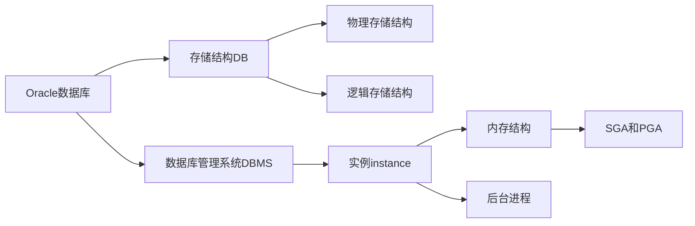

<span id="jump1">目录</span>

Oracle内容庞大,推荐看《Oracle 11g数据库基础教程》，此文档只包含常用内容

# 安装与卸载

[回到目录](#jump1)

## 安装

setup->网络配置(监听器)->SQL PLUS(查看能否登录，用户名system)

## 企业管理器OEM

浏览器https://本机:1158/em
确保Oracle服务、监听服务和控制台服务打开

默认控制台服务(即OEM控制台服务)端口为1158
查看在\app\product\11.2.0\dbhome_1\install\portlist.int

# 文件体系结构

[回到目录](#jump1)

![![oracle数据库系统结构]](/images/oracle数据库系统结构.png.webp)

admin:以数据库为单位，存放数据库运行过程中产生的跟踪文件
cfgtoologs:运行dbca、emca和netca图像化程序时产生的日志信息
checkpoint:存放数据库检查点信息
diag:以组件为单位，存储数据库各个组件运行的诊断信息
flash_recovery_area:以数据库为单位，数据库自动备份时，存放备份文件和闪回日志文件
oradata:以数据库为单位，存放数据库的物理文件(数据，控制，重做日志)
product:存放数据库管理相关的软件，包括可执行文件、网络配置、脚本



## 物理存储和逻辑存储

![![oracle数据库物理存储结构和逻辑存储结构]](/images/oracle数据库物理存储结构和逻辑存储结构.png.webp)

表空间：数据文件=1：n             块：OS块=1：n

**物理文件**：参数文件(库名，CTL路径，进程)，跟踪文件(记录运行过程发生的大事)+告警文件（记录后台进程活动）
数据文件：DBF
日志文件：LOG
控制文件：CTL(库名，数据和日志文件路径，建库日期）

逻辑文件：**表空间**(系统表SYSTEM，辅助系统表SYSAUX，临时表TEMP，撤销表UNDO，USERS)，**段**(数据，索引，临时，回退)，**区**(连续的数据块，存储空间分配的最小单位)，**块**(最小逻辑存储单元)

## 内存结构和后台进程

### SGA和PGA

SGA系统全局区：数据高速缓冲区、共享池（库缓存和数据字典缓存）、重做日志缓冲区、大型池、Java池、流池和其他

高速缓冲区：脏缓冲块(修改过的数据)+空闲缓冲块(无数据)+命中缓冲块(正在被使用的数据)+干净缓冲块(没被修改的数据)。
库缓存：通过硬解析(未执行的SQL)和软解析(已执行的SQL)来让相同的SQL语句不再编译，提升SQL执行效率。

PGA程序全局区：排序区、游标信息区、会话信息区、堆栈区(会话变量)

### 后台进程

| 进程名             | 作用                                                         |
| ------------------ | ------------------------------------------------------------ |
| 数据库写入进程DBWR | 将高速缓冲区的脏缓冲块写入数据文件                           |
| 日志写入进程LGWR   | 将重做日志缓冲区的记录写入重做日志文件                       |
| 检查点进程CKPT     | 类似时间节点，每到检查点就执行上面的操作，并保存节点         |
| 系统监控进程SMON   | 系统崩溃时恢复系统（通过联机重做日志文件）;合并空闲表空间碎片 |
| 进程监控进程PMON   | 同上仅针对用户进程                                           |
| 归档进程ARCH       | 重做日志写满时，复制到归档目标                               |
| 恢复进程RECO       | 自动解决分布式数据库出现的事务故障                           |
| 锁进程LCKn         |                                                              |
| 调度进程Dnnn       |                                                              |

归档模式开启：LOG_ARCHIVE_START=TRUE

# 安全管理

[回到目录](#jump1)

## 用户管理

## 权限管理

## 角色管理

## 表空间管理

**表空间类型、名称、数据文件、表空间管理方式、区分配方式和段管理方式**
表空间管理：字典dictionary管理方式、(默认)本地管理方式local
区分配方式：在表空间本地管理中，区分配有(默认)自动分配autoallocate和定制分配uniform
管管理饭时：(默认)自动管理auto和手动管理manual

~~~sql
-- 创建表空间
create [temporary|bigfile|undo] tablespace 名字
[datafile|tempfile] '文件路径\名字.DBF' size 10M
[autoextent on next 1M maxsize unlimited] -- 数据文件自动扩展
[extent management local uniform size 10M] -- 段定制分配
[segment space management manual] -- 区手动管理

大文件表空间 段只能自动管理,临时表空间和撤销表空间 区只能自动分配

-- 修改表空间

~~~

# 语法相关

[回到目录](#jump1)

## 求余

| mysql  | sql server | Oracle |
| ------ | ---------- | ------ |
| %、mod | %          | mod    |

## DDL、DML、DQL(没写的默认和其他sql一样)

| 表相关功能 | 语法                                                         | 说明                                                         |
| ---------- | ------------------------------------------------------------ | ------------------------------------------------------------ |
| 建表1      | create table 表名(。。。。)                                  | 同mysql                                                      |
| 建表2      | craete table 表名(列.....) as select .....                   | 用子查询建表                                                 |
| 修改表     | alter table 表名<br />[add 新列 类型 约束]<br />[modify 列 类型]<br />[set unused coumn 列]<br />[drop column 列]<br />[rename column 旧列名 to 新列名]<br />[rename to 新表名] | <br />加新列<br />改类型<br />设置不使用列<br />删除列<br />重命名列<br />重命名表 |
| 修改约束   | alter table 表名<br />[add constraint 约束名 主键\|唯一\|检查\|外键]<br />[modify 列 not null]<br />[drop constraint 约束名]<br />[drop unique(列)] | <br />添加主键外键唯一检查约束<br />添加非空约束<br />按约束名删除<br />按列约束删除 |
| 删除表     | drop table 表名<br />[cascade constraints]<br />[purge]      | 在Oracle中删除表会重命名表并放在回收站(用来实现闪回删除flashback drop擦操作，清空回收站purge recyclebin) |

| 数据相关功能 | 语法                                                         | 说明                                                         |
| ------------ | ------------------------------------------------------------ | ------------------------------------------------------------ |
| 插入1        | insert into 表(列...) values (列...)                         | 单条数据                                                     |
| 插入2        | insert into 表 select ...                                    | 子查询                                                       |
| 插入3        | insert all<br />[into 表1 values(列...)]<br />[into 表2 values(列...)]<br />select... | 多条数据                                                     |
| 插入4        | insert all\|first<br />when 条件1 then into 表1(列...)<br />when 条件2 then into 表2(列...)<br />else into 表3(列...)<br />select ... | 条件多表插入<br />all表示只要满足条件就插入<br />first表示只插入满足条件的第一个表 |
| 插入5        | insert / * +append */ into 表 select...                      | 插入大量数据使用装载(不写入日志)                             |
|              |                                                              |                                                              |
| 数据合并     | merge into 目标表 using 源表<br />on(条件)<br />when matched  then update set...<br />when not matched then insert values(...) | 将满足on条件的源表数据更新或插入到目标表                     |

## select注意事项

- 拼接符号：||

- 交、并、差：intersect、union、minus

- order by 2         将select结果按第2列排序

- 使用ROWNUM来显示行号，在select结果集里面直接加ROWNUM

- ROWID是数据的物理地址

rowid=对象编号6+数据文件编号3+块编号6+行编号3

# 事务

设置事务只读模式(该模式下，开启事务之后只能查询数据)
set transaction read only；

```sql
begin
...
savepoint A;
...
rollback to [A];|commit;|rollback;
[exception
 when others then rollback to A;]
end;
```

其他内容同mysql

# 序列

**序列不占用实际存储空间**

```sql
-- 创建序列
create sequence 序列名
[start with n]             -- 设置初始值，默认1
[increment by m]           -- 步长，默认1
[maxvalue mm|nomaxvalue]   -- 序列最大值mm
[minvalue mm|nominvalue]   -- 序列最小值mm
[cycle|nocycle]            -- 达到最大值或最小值时，循环
[cache n|nocache]   -- 设置预先分配并保留在内存中的序列个数，默认20
-- 使用序列
同rownum伪列，序列有currval和nextval两个伪列
序列名.currval返回当前序列值
序列名.nextval产生新值并返回
使用范围：select和insert目标列，insert values子句，update的set子句
```

# 视图

查询简单化、数据安全性、逻辑数据独立性

```sql
create [or replace][force|noforce] view 视图名 -- force不管有无基表强制创建视图
as
select...
[with check option] -- 对试图操作时，必须满足子查询中的约束条件
[with read only] -- 只读
```

# 同义词

create synonym 名称 for 表名

# 函数

[回到目录](#jump1)

## 日期函数

| 函数                  | 说明                                            |
| --------------------- | ----------------------------------------------- |
| add_months(d,n)       | 日期d+n个月,n可为负数                           |
| extract(year from d)  | 从日期d中截取,year,month,day,hour,minute,second |
| sysdate               | 系统时间                                        |
| last_day              | 当月最后一天日期                                |
| months_between(d1,d2) | 相差月数                                        |

## 其他函数

| 函数                                | 说明                                                    |
| ----------------------------------- | ------------------------------------------------------- |
| nvl(a,b)                            | a为空，返回b,否则返回a                                  |
| nvl2(a,b,c)                         | a为空,返回c，否则返回b                                  |
| nullif(a,b)                         | a=b,返回null，否则返回a                                 |
| decode(expr,a,b,a1,b1,.....default) | 表达式expr，为a时返回b，为a1时返回b1,....<br />否则默认 |

# PL/SQL

| orcle功能函数               |                                                              |
| --------------------------- | ------------------------------------------------------------ |
| 设置打印(默认开启)          | set serveroutput on                                          |
| 输出内容并换行              | DBMS_OUTPUT.PUT_LINE()                                       |
| 放进缓冲区，不换行输出      | dbms_output.put('Hello, Lao An ');<br />dbms_output.put('Hello, Lao An '); |
| 输出换行                    | dbms_output.new_line();                                      |
| 输入(注意&后可以接任意内容) | i:=&i                                                        |
| 产生从n到m的随机数          | dbms_random_value(n,m)                                       |

## 数据类型

| 类型 | 种类                             | 说明                                             |
| ---- | -------------------------------- | ------------------------------------------------ |
| 数字 | number(p,s)                      | p有效位，s小数位                                 |
| 字符 | char()<br />varchar2()           | 定长char；变长varchar2                           |
| 日期 | date<br />timestamp              | 日期date；时间点timestamp                        |
| 布尔 | boolean                          | true，false，null                                |
| LOB  | blob,clob,nclob,bfile            | 二进制blob；文本clob,nclob;操作系统文件指针bfile |
| 记录 | type 名称 is record(<br />.....) | 类似结构体                                       |

%TYPE和%ROWTYPE
已知存在表emp中的sal列，但不知道数据类型，想要定义一个相同的数据类型
a emp.sal%TYPE
b emp%ROWTYPE   定义一个与emp表结构一致的记录类型

```sql
declare
声明各种变量
begin
...;
select ...into..;
insert,update,delete...;
...;
end;
```

## 关键词

```sql
-- 选择结构
-- if
if 条件 then 情况1;
elsif 条件2 then 情况2;
else 情况3;
end if;

-- case
case
when ... then ...;
when ... then ...;
else ...
end case;

-- 循环while for loop
-- 循环以end loop结束
loop
...;
exit when 条件;
...;
end loop;

while 条件 loop
...;
end loop;

for i [reverse] in n..m loop   -- 变量i从n到m循环,反转后从m到n
...;
end loop;

-- 跳转结构GOTO
...;
<<a>>    -- 定义跳转点
...;
goto a;  -- goto跳转到跳转点
...;
```

## 游标

在PL/SQL块中执行select和DML，分配缓冲区，名为上下文区，游标是**指向该缓冲的指针**

显式游标：用户定义、操作，处理返回多行数据的select查询
隐式游标：由系统自动操作，处理DML和返回单行数据的select查询

### 显示游标

```sql
-- 定义(可带参数)
CURSOR 游标名 IS select语句
CURSOR 游标名(变量) IS select语句
-- 打开(open之后游标指向第一行)
open 游标名
open 游标名(&变量)
-- 检索(每执行一次fetch指针后移)
fetch 游标名 into 一个能存一行数据的变量
-- 关闭
close 游标名

-- 通过loop，while，for来循环检索的区别
loop
	fetch...into..;
	exit when 游标%notfound;
end loop;

fetch...into..;
while 游标%notfound loop
	fetch...into..;
end loop;

for 记录行变量 in 游标名 loop
...;
end loop;
```

| 游标属性              | 语法                                                         |
| --------------------- | ------------------------------------------------------------ |
| %isopen               | 是否开启                                                     |
| %found 或者 %notfound | 上次使用fetch时是否检测到数据,可以作为游标循环检索的判断条件 |
| %rowcount             | 返回检索个数                                                 |
| %bulk_rowcount(i)     | 取得forall语句执行批绑定时第i个元素影响的行数                |

### 隐式游标

**指向SQL语句执行的缓冲区的指针**，又称SQL游标(静态游标)

隐式游标属性同显式游标,相当于一个游标名称为SQL的游标
SQL游标主要用来处理insert、update、delete、单行的select...into

#### 游标变量

定义游标引用类型：TYPE 游标引用类型名a IS REF CURSOR [RETURN 返回类型]
引用上面定义：游标变量名 a
在Oracle有一个预定义的游标引用类型sys_refcursor

```sql
-- 定义游标变量
游标名 sys_refcursor;
-- 打开游标变量
open 游标变量名 for select...
-- 检索游标变量
loop
fetch 游标变量 into 变量;
...;
exit when ...;
end loop;
-- 关闭
close 游标变量名;
```

## 异常

预定义异常，非预定义异常，用户定义异常

## 存储过程

声明形参时**不能定义长度或精度**，有默认值的参数放在参数列表最后。

```sql
-- 定义
create [or replace] procedure 存储过程名(变量名 in|out|in out 数据类型 [:=默认值])
as
定义变量;
begin
执行部分;
exception
when...then...异常处理部分;
...;
end;

-- 调用
execute|call 存储过程名;
在PL/SQL直接当成函数执行
```

## 存储函数

```sql
-- 定义
create [or replace] function 函数名(变量名 in|out|in out 数据类型 [:=默认值])
return 数据类型;
as
定义变量;
begin
执行部分;
return 变量;
exception
异常处理部分;
end;

-- 调用
PL/SQL中使用直接调用
在SQL语句中直接使用
```

## 触发器

一种特殊的存储过程系统自动调用执行，不能显式调用，不接受参数

| 作用对象不同类型 | 说明                                        |
| ---------------- | ------------------------------------------- |
| DML触发器        | 在基本表上的触发器，响应增删改操作          |
| INSTEAD OF触发器 | 视图上的触发器，响应增删改操作              |
| 系统触发器       | 系统或模式上的触发器，响应系统事件和DDL操作 |

```sql
-- 创建DML触发器(语句级、行级for each row使用到:old、:new)
create [or replace] trigger 触发器名
before|after insert or delete or update
[of 列名] on 表名
[for each row]   -- 行级触发器
[declare 变量]
begin
...;
-- 条件谓词：inserting、updating、deleting
-- if 判断词 then或者 when 判断词 then
-- 行级DML标识符   :old.列名  :new.列名  在when中使用不加:
...;
end;

-- 创建变异表触发器
-- 更新变异表同时查询变异表：在行级触发器中获取要修改的记录的信息，存放到一个软件包的全局变量中，然后在语句级后触发器中利用软件包中全局变量信息对变异表的查询
```

# 备份与恢复

冷热备份，归档模式

## 物理备份

## 物理恢复

## RMAN备份

## RMAN恢复

## 逻辑备份

导出：exp
exp 用户名/密码@实例名 file=备份文件路径.dmp full=y
存入一个二进制转储文件：*.dmp

## 逻辑恢复

导入：imp
